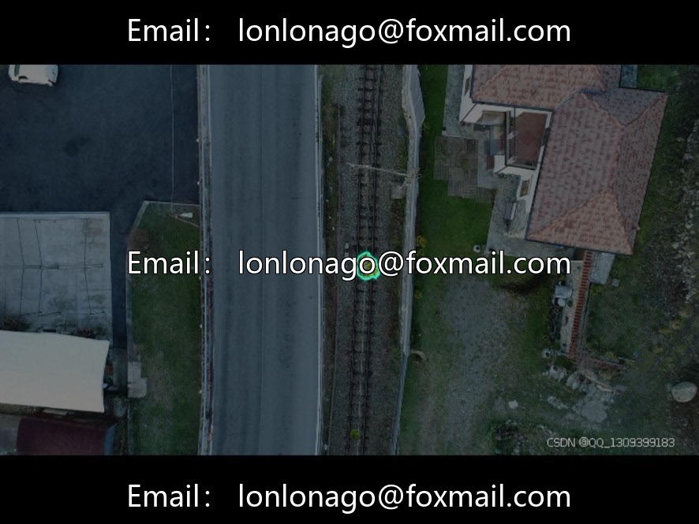
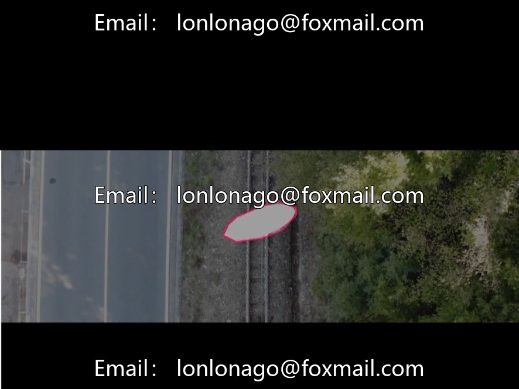
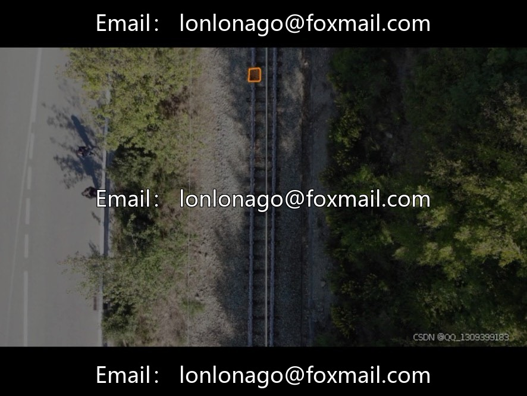
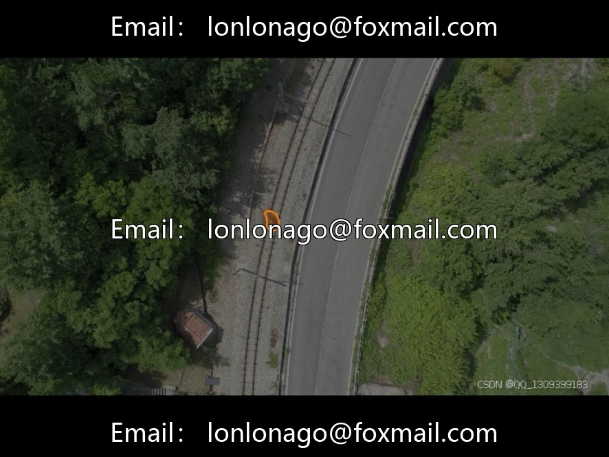
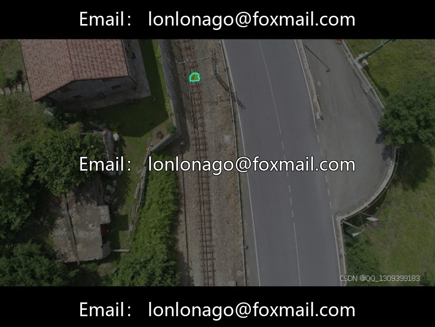

# Railway Track Natural Obstacles Instance Segmentation Dataset | Issue 10042

## Body

Railway Track Natural Obstacles Instance Segmentation Dataset | Issue 10042
DJI UAV Aerial Photography Railway-Specific Instance Segmentation Dataset for identifying natural safety hazards such as track rocks, invading trees, etc., compatible with segmentation models like Mask R-CNN and YOLO-seg.

Basic Scale
- A total of 1201 aerial images, medium scale
- Covers various lighting conditions and real scenes along the line, after filtering out blurry and invalid images, suitable for railway field training in complex environments.

Four major annotation categories (natural obstacles)
1. Fallen-tree: Trees fallen on the tracks, directly blocking traffic
2. General-tree: Overly extended trees along the track that pose a risk of intrusion
3. General-rock: Small rocks scattered or rolling down
4. Rock: Large high-risk rockfalls, distinguishing from ordinary gravel

Data set division
- Officially, no fixed split is provided; industry common practices are to divide training/validation/test sets at a ratio of 7:2:1 or 8:1:1.
- Training set for feature learning, validation set for hyperparameter tuning to prevent overfitting, and independent test set for evaluating generalization capability.

Image resolution
- Mainly 1280×720, 1920×1080 high definition specifications, with sufficient picture details, can accurately distinguish the size of stones and tree branches, meeting the example segmentation pixel-level annotation requirements.

Landing application scenarios
1. Automatic train operation visual warning system, real-time identification of track rocks and fallen trees, and triggering braking.
2. Unmanned aerial vehicles/cameras along the railway line for intelligent inspection 24 hours, replacing manual investigation of hidden dangers.
3. Operation and maintenance data analysis, statistical analysis of rockfall and tree-related incidents, and the formulation of pruning and slope reinforcement plans.
4. Segmentation algorithm academic research, provide standardized training materials for railway object segmentation models

Virtual materials, once sold, are non-refundable.
Interested friends, click "I want" to proceed.

## Images

## Payment

Here is a pay link on Stripe ( https://buy.stripe.com/3cs8yP7sY87d0vu9AB ). Please contact me lonlonago@foxmail.com after funding $89, and I will send you a complete data files , thank you!

